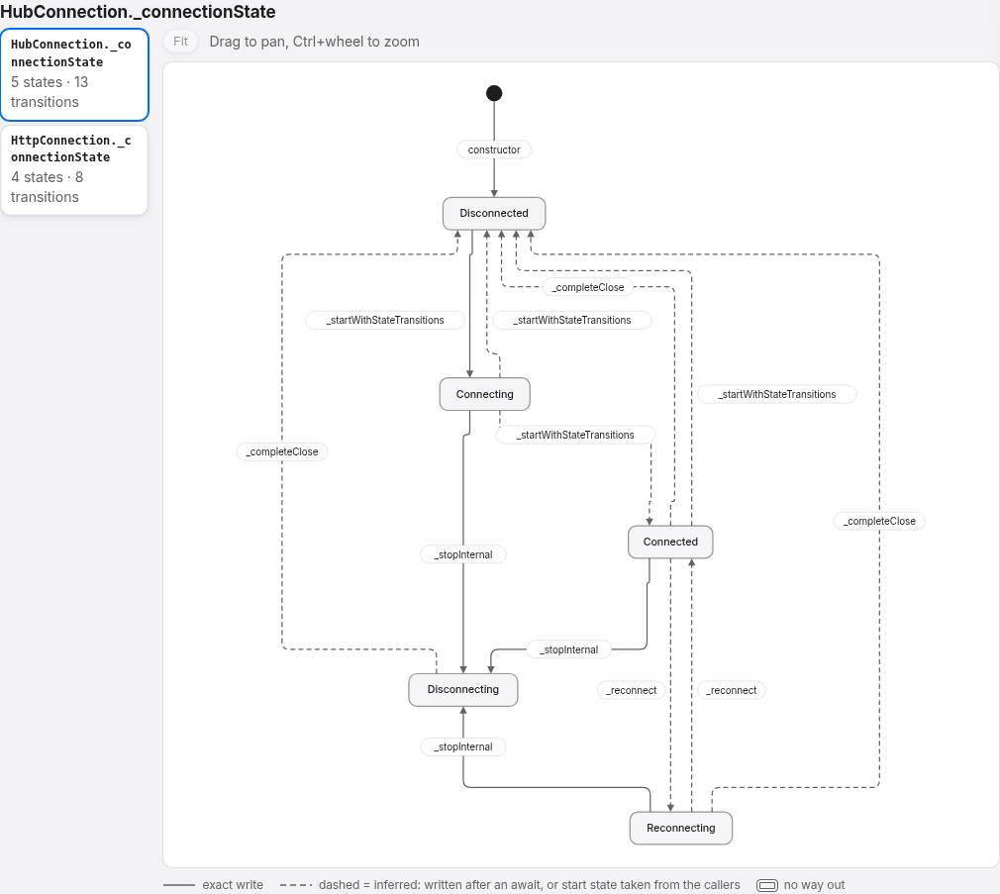
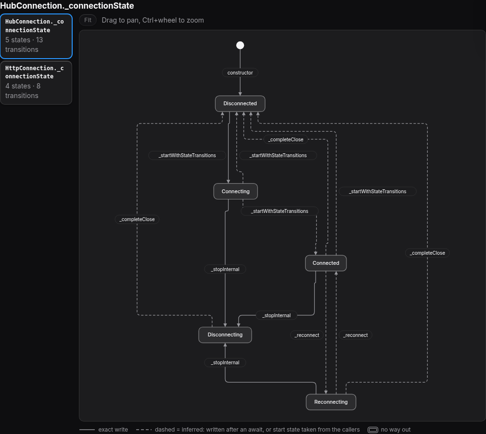
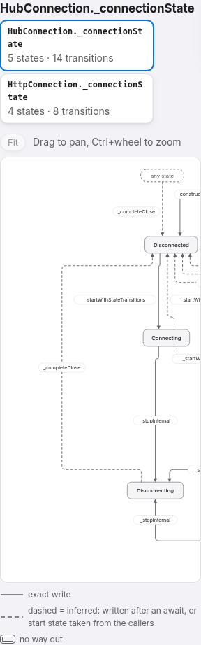
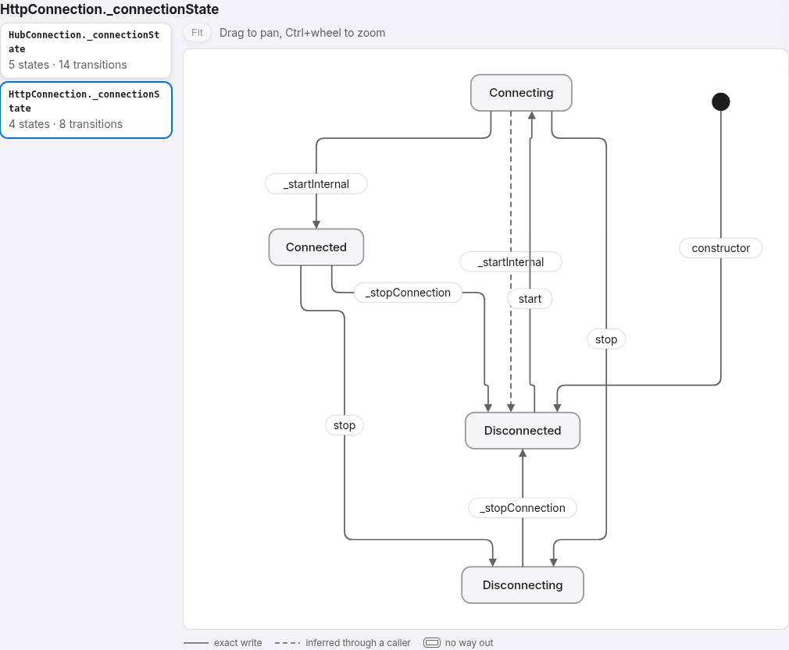
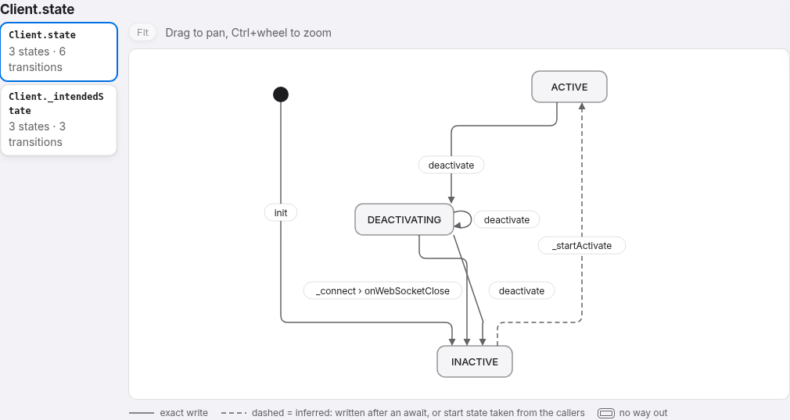
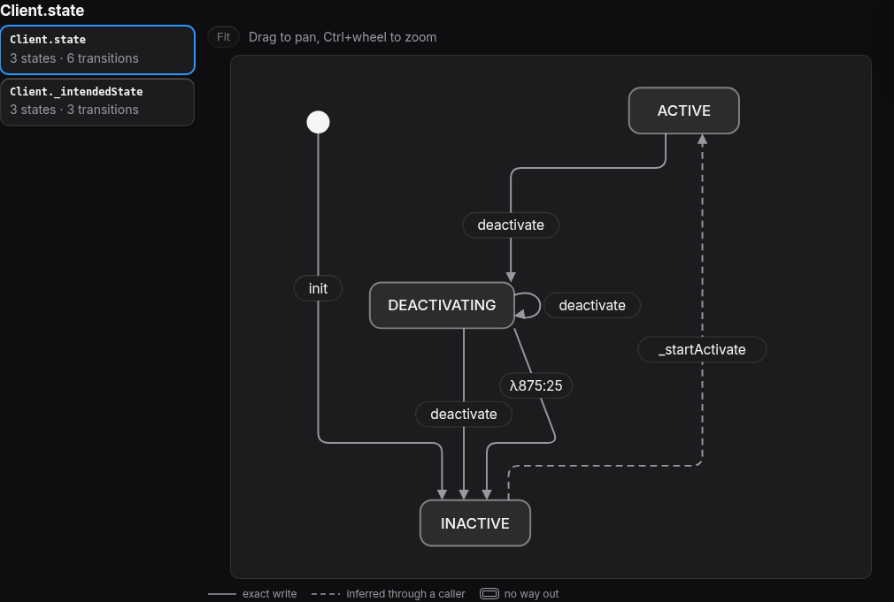
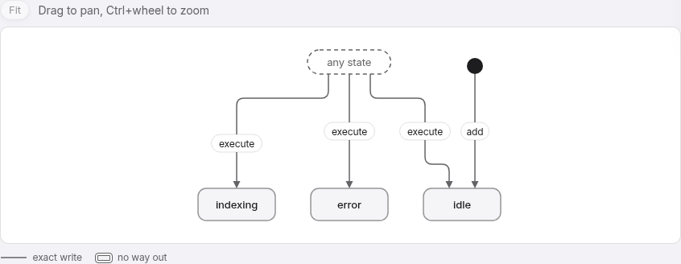

# The States lens

The States lens (`lens-states`) finds explicit state machines in the code and draws one diagram per machine. A state machine here is a field or variable whose declared type is a finite set of values (an enum or a union of literals), together with the places that write it and the places that test it. The lens reports what the IR shows. It does not guess at states the type does not name.

The lens needs the `state` facet, so it is unavailable on a project that no frontend gives state facts for. The TypeScript frontend emits them, and the C++ frontend emits a heuristic version (see "The C++ dialect").

## What it shows

Open the States tab. Each machine is one entry in a list; the selected one is drawn as a state diagram beside it.

The picture is `HubConnection._connectionState` from the SignalR TypeScript client. Each box is a value of the `HubConnectionState` enum. Each arrow is a write that moves the field from one value to another, labelled with the function that does it. Under the diagram is a legend, and below it are two tables: the machines and every transition site.

The same page in the dark theme, and in a narrow pane:

A phone-width view is in [signalr-hub-phone.png](screenshots/states-lens/signalr-hub-phone.png).

## How to read a diagram

- **Start dot.** The filled dot (`●`) is the start. An arrow from it goes to every value the holder is initialised with: a field initialiser, a constructor assignment, or a declaration initialiser. It is drawn only when some write is an init.
- **Boxes.** A box is a value, written the way the domain spells it (`Connected`, not `HubConnectionState.Connected`). Values come from the declared type, plus any value that is written or tested but is not in the type.
- **Solid and dashed arrows.** A solid arrow is *exact*: the write is not after an await, and the frontend knows the holder's value just before it, from a guard or from an earlier write in the same function. A dashed arrow is *inferred*. That is one of two things:
  - the write comes after an `await` (or `yield`), so another task may have changed the holder while this one was suspended; or
  - the write has no guard in its own function, and its start state was taken from the callers (see "Cross-call fill").

  The legend says the same: "dashed = inferred: written after an await, or start state taken from the callers". An inferred arrow is likely right, but the analysis could not prove it. A dotted arrow is *heuristic*; only the C++ frontend produces those.
- **One arrow, many sites.** Writes with the same start, end and label are merged into one arrow. The arrow is as sure as its best site: one exact site proves the transition exists.
- **Arrow labels.** The label is the `case` label of an enclosing switch on a different value (a reducer's `case "start"`), otherwise the name of the function that writes. A write inside a lambda is labelled `outer › name`, or `outer › λ`.
- **Self-loops.** An arrow from a box to itself is drawn on its right side.
- **"any state".** A dashed pill labelled "any state" means a write with no known start. Nothing in the function, and nothing from its callers, bounds the value the holder has. Arrows from it say "this write can happen from any state". It is drawn only when some write needs it.
- **"no way out".** A box with a double border has no arrow leaving it. The legend names it "no way out". It may be a real end state, or the code that leaves it may be outside what the lens can see.
- **Greyed boxes.** A box with a thin dashed border and grey text is a value of the type that no write or init sets. The legend calls it "never entered". See also the `unentered` finding.
- **Hover and focus.** Hovering a box or an arrow brightens its arrows and dims the others. Tab moves through the boxes and arrows; Enter or Space picks one.
- **Click an arrow.** The first site of the arrow opens in the source pane, and the side panel lists every site: the function, a `file:line` link, the guard text (or "no guard") and the confidence of that site. Sites can differ in confidence inside one arrow.
- **Click a box.** The source pane opens the first write that enters that value, or the holder's declaration when nothing enters it.
- **Pan and zoom.** The diagram is fitted to the pane. Drag the background to pan, hold Ctrl (or Cmd) and use the wheel to zoom, and press Fit to go back.
- **Narrow panes.** The diagram never shrinks below 60 % of its natural size. A wider diagram scrolls inside its frame, and the machine list moves above the diagram below 700 px.
- **Notes.** Text under the diagram says when the domain is unknown, when the holder is declared outside the scope, and how many dynamic writes are not drawn.

The selected machine is kept in the page hash as `machine=<holder id>`, next to `scope=` and `line=`, so a reload or a shared link opens the same machine.

## The TypeScript dialect

The frontend uses the TypeScript type checker, so a value counts when the checker can name it. It needs no `node_modules` to find a union or an enum declared in the project.

### Holders

A holder is one of:

- a class or interface property, or a member of a type-alias object type;
- a constructor parameter property (`constructor(private s: S = S.A)`);
- a module variable or a function-local `let` (not `const`);
- a React `useState<T>` slot with a finite `T`. Its id is `<file>#<Component>/<name>`. The domain is read from the type argument. Without a type argument the domain is open.

Its declared type must be finite:

- an enum (including `const enum`), a union of string or number literals, or an alias of either;
- `| null | undefined` is allowed and becomes the value `∅`;
- `boolean`, `string` and `number` are never holders. There is no setting to turn booleans on.

There is one holder per declaration: `<file>#<Type>.<prop>` for a field. All instances of a type share it.

### Writes

Each of these is a `state.write` node. A write has a value when the checker sees a single literal type or an enum member, so `const IDLE = "idle"; x.status = IDLE` works. Otherwise it is *dynamic*: counted, listed in the notes, and given no arrow.

- an assignment `this.s = S.A` or `s = S.A`;
- an object-literal property whose contextual type has the holder as that property: a patch (`registry.update(id, { status: "indexing" })`), a reducer result (`{ ...state, status: "done" }`), `setState({ ... })`, or a constructed object;
- a declaration initialiser, a `useState` initial argument, a parameter-property default, and an object literal with no spread whose type is exactly the declaring type. These have `op: "init"`. Everything else is `op: "set"`;
- a call to a *setter helper*: a function or method that, with no earlier statement able to leave it, assigns one of its parameters straight to the holder, once (`_changeState(state) { this.state = state; ... }`). Each call with a literal argument is a write at the call site, with `via` set to the helper. The assignment inside the helper emits nothing. A `useState` setter works the same way;
- an assignment through a set accessor that stores its parameter in a holder (`set s(v) { this._s = v }`) counts as a write with `via`.

### Accessors, predicates and tests

A test is a `state.test` node: a comparison of a holder with literal values.

- `===`, `!==`, `==`, `!=`, either way round, with `as`, `!` and parentheses stripped (`(this.s as any) === X` counts);
- `switch (h)`, one test per case group (empty fall-through cases merge into one test with several values).

A test guards only when it is the whole condition, or a top-level `&&` conjunct, or the `!` of one. A comparison inside `||` or a call argument is counted but guards nothing. An early exit (`if (h !== V) return;`) makes the rest of the block run only when `h` is in `V`.

Reads through accessors count:

- a plain getter `get x() { return this._x }` reads the holder `_x`;
- a *predicate* is a getter, or a zero-argument method, whose body is one `return` of a comparison of `this.h` with literals, or of the `!` of another predicate. Using it in a condition (`this.active`, `this.isActive()`, `!this.active`) is a test at the use site. It guards like a direct test, early exits included. stompjs `get active()` is one.

## Confidence and guard rules

For each function the frontend runs a small abstract interpretation over the AST. For each holder (and receiver text) it tracks the *known set* of values the holder can have. At function entry the set is "entry": unknown, but marked as the caller's value. Each write records the set as `from`. The lens turns `from` into arrows.

- **Guards narrow.** A positive test keeps the tested values. A negative test removes them from the domain. An empty result is treated as unknown, never as "impossible".
- **A write replaces the set** with the value written, for the code it dominates. A second write in the same function therefore starts from the first.
- **Early exits.** `if (h !== V) return|throw|continue|break` narrows what follows. Branches join by union.
- **Receivers.** A write and a test that share the receiver text (`this`) match exactly. A write with no receiver (an object-literal patch) matches a test of the same holder on any receiver in the same function. That match is `holder`, not `receiver`, and gives an inferred arrow.
- **await and yield make the set stale.** A write from a stale set is drawn inferred. A re-test after the await (SignalR's `!== Reconnecting` re-checks) replaces the set with the tested values and makes it fresh again.
- **try, catch, finally.** A `catch` starts from the set at the `try` entry plus every value written in the `try` that a later call, `await`, `new` or `throw` in that `try` can follow. A write after which nothing can throw adds nothing. A `finally` is analysed from the normal exit, the exception paths, and every `return`, `break`, `continue` and `throw` that crosses it. What follows the `finally` comes from the normal paths only.
- **Loops.** A loop body starts from the entry set plus what the body writes. The frontend iterates, widens the values that keep changing to unknown, and iterates until nothing moves. A fixed work budget per function (20,000 statement steps) stops this on deeply nested loops; past it, holders are widened to unknown.
- **switch.** Each case group narrows by its own values. `default` narrows by the values of the other groups. A switch on a different value gives a write its `event` label.
- **What invalidates the set.** A call to a method of the same class that writes the holder, directly or through other methods of the class, makes the set unknown. So does a synchronous callback that writes it (an IIFE, the `new Promise` executor, `forEach`, `map`, `filter`, `some`, `every`, `find`, `findIndex`, `reduce`, `flatMap`, `sort`) when it is inside a called method. A `this.x()` call that cannot be resolved, or whose member is abstract, interface-typed or a function-valued property declared in project source, makes every holder of the class unknown. Members declared in `.d.ts` files, the lib or `node_modules` do not. Stored or deferred callbacks do not count (see "Limits").
- **Dynamic writes** have no value, so they give no arrow and set the holder unknown.

### Cross-call fill

A write with no `from` is filled from the callers only when its start is exactly the function's entry set. The frontend marks such a write `fromEntry: true`. On each `this.m()` call it also writes the known sets onto the `calls.call` edge: `knownState` maps a holder id to its values, `knownStale` lists holders whose value may be out of date, and `knownEntry` lists holders whose set at the call is the caller's own entry set.

The lens then fills a `fromEntry` write from the callers of its function. It uses exact, single-target calls only:

- a caller with `knownState` for the holder gives those values;
- a caller with `knownEntry` for the holder passes the question one level up, to that caller's own callers. The total depth is at most 2, and cycles are cut;
- a caller with neither, a callback, or a caller outside the view gives `any state`, kept alongside the other arrows.

Every arrow filled this way is inferred. A stale entry set is still used; the arrow is inferred anyway. A write that lacks `from` for another reason (a dynamic write, a join with an unknown side, loop widening, an invalidating call) is not filled and draws from "any state".

### Putting it together

For each write the lens draws:

- `● → value` for an init;
- `f → value` for each `f` in the write's `from`;
- `any state → value` when nothing bounds the start.

An arrow is exact when its write is exact, not stale, and its guard matches by receiver. It is inferred when the write is stale, the guard matches only by holder, or the start came from the callers.

### When a holder becomes a machine

A holder is drawn when it has at least two distinct written values (an init counts) and at least one `set` write. Tests are not needed. Other holders are counted in the `holdersSkipped` metric. This keeps out data tags that are written once at construction.

### Metrics and tables

Metrics: `holders`, `machines`, `states`, `transitions`, `exact`, `inferred`, `heuristic`, `unguardedWrites`, `dynamicWrites`, `holdersSkipped`, `testsWithoutArm`, `staleWrites`. A project with no holders shows zeros and "Nothing to show"; it is not a clean bill of health.

Two tables follow the diagram. `machines` has one row per machine: holder, file, domain, state count, transition count, exact, inferred, unguarded and dynamic. `transitions` has one row per site: holder, from, to, event, guard, confidence, function and line. Each row links to its source line.

## The C++ dialect

The C++ frontend (`packages/frontend/cpp/src/state.ts`) is syntactic, and every fact it emits has confidence `heuristic`, so arrows are dotted.

- A holder is a non-const field, or a global, whose declared type text names an enum the project declares. The values are the enum's members as `Type.Member`.
- A write is `x = E::M`, `this->x = M`, `x_ = M`, or a member initialiser, default member initialiser or global initialiser (an init). A bare member name is read as a field of the enclosing class. A parameter or local with the same name hides the field. A global is used only when its name is unique.
- A test is `==` or `!=` against an enumerator, or `switch (x)` with `case E::M:`. The frontend emits branch arms for `if`, `else` and `case`.
- Guards are resolved the same way: arms, early exits, switch groups, and a write replaces the set. Loops and `try` blocks widen what they write to unknown.

It has no cross-call knowledge, no stale marking, no predicates and no setter helpers, and it ignores macros and templates.

## The IR contract

The lens reads three node kinds of the `state` facet, and optional attributes on `calls.call` edges.

| Kind | What it is | Main attributes |
| --- | --- | --- |
| `state.holder` | A field, variable or `useState` slot of a finite type | `name`, `domainKind` (`enum`, `union`, `open`), `values`, `declaredType` |
| `state.write` | One site that sets a holder | `holder`, `op` (`init`, `set`), `value` or `dynamic`, `receiver`, `from`, `fromEntry`, `stale`, `guards`, `guardMatch`, `event`, `guardText`, `via` |
| `state.test` | One comparison of a holder with literals | `holder`, `values`, `negated`, `receiver`, `arm`, `elseArm`, `exitGuard` |
| `calls.call` (existing edge) | | optional `knownState`, `knownStale`, `knownEntry` |

A value is a JSON-quoted string (`"idle"`), a bare number (`3`), an enum member (`Type.Member`), or `∅`. So `"3"` and `3` stay distinct. A `set` write needs a `value` or `dynamic: true`; the schema rejects one with neither. The holder is an id string, not an edge, so a scope cut never makes a stub of it.

The full rows are in [ir-reference.md](ir-reference.md), and the schema is `packages/core/ir/schema/facets/state.schema.json`. Other lenses' reuse keys do not include the `state` facet, but the `calls.call` attributes change the `calls` facet, so lenses that read it run once after the frontend upgrade.

The lens is `lens-states`, version 0.1.1. It requires `structure` and `state`, and reads `flow` and `calls` when present. It has no settings file. Its views are one `state-machine` view per machine (see [writing-a-lens.md](writing-a-lens.md)) and the two tables above.

## Scope behaviour

The lens reads the scoped IR (see [scoped-ir.md](scoped-ir.md)).

- Machines are built from the writes and tests whose files are in the scope.
- A holder declared outside the scope has no `state.holder` node there. Its machine is drawn with the note "Holder declared outside this scope: domain unknown", with no greyed values.
- A caller outside the scope is not in the view, so a write that depends on it keeps "any state".
- Findings are produced only on the project pass (no scope, or the root). A scope cut drops writes, and the findings would be wrong.
- The arrows of a narrower scope are a subset of those of the wider scope.

## Findings

Two findings, on the project pass only, and only for machines that are drawn:

- `unentered:<holder id>|<value>` (warning): "X is never set to V". A value of the declared type that no write or init produces. It is raised only when the holder has at least three distinct written values, because a narrow use of a shared enum (two values of five) is usually deliberate.
- `dead-test:<test id>` (info): "X is tested for V, but nothing sets it". A test of a value that no write produces.

Neither is raised for an open-domain holder, or for a holder with any dynamic write, because the dynamic write could produce the value. Terminal states, unguarded writes and dynamic writes are metrics, not findings.

## Worked examples

### SignalR: Hub and Http

Index `src/SignalR/clients/ts/signalr` from `dotnet/aspnetcore` (a sparse checkout; the hosted path takes the whole monorepo tarball and cannot). The machine list has `HubConnection._connectionState` and `HttpConnection._connectionState`. The Hub diagram is the first screenshot above.

In `HubConnection`:

- `● → Disconnected` is the constructor.
- `Disconnected → Connecting` in `_startWithStateTransitions` is solid. An early exit `!== Disconnected` bounds the start.
- `Connecting → Connected` in the same function is dashed: the write is after an `await`.
- `_stopInternal` writes `Disconnecting` after early exits on `Disconnected` and `Disconnecting`. Its three arrows from `Connecting`, `Connected` and `Reconnecting` are solid.
- `_completeClose` writes `Disconnected` under a non-state guard. Its arrows are dashed: the start comes from its callers, `_connectionClosed` and `_reconnect`, one level up.
- `_reconnect` writes `Reconnecting` (start from the caller) and `Connected` (after an `await`), both dashed.
- The `catch` of `_startWithStateTransitions` writes `Disconnected` from `Connecting` and from `Connected`. The second is a twin of the first: a `Connected` written in the `try` is followed by a call that can throw. It is dashed.

Most Hub arrows are dashed because SignalR writes after awaits and in helpers. The legend says why.

`HttpConnection._connectionState` has fewer arrows. `_stopConnection` is solid, `Connected | Disconnecting → Disconnected`, from its own early exits, even though its callers are callbacks.

### stompjs: Client.state

Index `stomp-js/stompjs` (`src/client.ts` and `src/types.ts`; small enough for the hosted path). `ActivationState` is a numeric enum with `ACTIVE`, `DEACTIVATING` and `INACTIVE`. Every write goes through the setter helper `_changeState(state)`, so each call with a literal is a write with `via` set to it. `get active()` is a predicate, so the `this.active` early exits guard.

- `● → INACTIVE` is the field initialiser.
- `ACTIVE → DEACTIVATING` and `DEACTIVATING → INACTIVE` are `deactivate`, solid. A second `deactivate()` re-enters `DEACTIVATING`, which is the real self-loop.
- `DEACTIVATING → INACTIVE` also comes from the `onWebSocketClose` handler in `_connect`, under a wrapping `if (this.state === DEACTIVATING)`. It has a different label, so it is a second arrow.
- `INACTIVE → ACTIVE` in `_startActivate` is dashed: its start is taken from the callers.

**A known over-approximation: `DEACTIVATING → ACTIVE`.** The dashed `_startActivate` arrow from `DEACTIVATING` to `ACTIVE` is one the code probably cannot take. Around line 885 the handler calls `onWebSocketClose`, a callback the user can replace, which may call `deactivate()`. Then `_startActivate` is called if `_intendedState` is `ACTIVE`. The analysis sees the caller's set as `DEACTIVATING`, and cannot correlate that with `_intendedState`, a second holder. So the arrow is drawn, dashed. Read it as "the lens could not rule it out".

`Client._intendedState` is the second machine in the list. It is really a flag, and has no `unentered` finding because it has fewer than three written values.

### This repo: ProjectRecord.status

`ProjectRecord.status` in `apps/server` is written by object-literal patches, not assignments (`registry.update(id, { status: "indexing" })`). It has the values `idle`, `indexing` and `error`.

Every arrow into `idle`, `indexing` and `error` is from "any state", except the start dot, which goes to `idle` (the `add` write). The writes are patches with no receiver, and no known start state reaches them, so the lens draws "any state". Nothing leaves a named state, so none of the three boxes has an outgoing arrow. This is correct, but it shows what the lens can't see: the code around the patch may know the status, and the lens does not follow a value through an `update(id, patch)` call.

## Limits

The frontend over-approximates (an arrow the code can't take) and under-approximates (an arrow the code takes but the lens misses). Both are listed here.

### False positives: arrows or findings that may not be real

- A dashed arrow is a claim the analysis could not prove: the write follows an await, or its start came from callers.
- Multi-holder correlation. Each holder is analysed alone. A guard on one holder says nothing about another, so two fields that move together give arrows the code can't take. stompjs `DEACTIVATING → ACTIVE` is the known case.
- A `catch` may keep a twin arrow from a value written last in the `try` when a later call could throw (a logging call counts). It is inferred.
- All instances of a type share one machine. A guard on `a.status` constrains `b.status` only when there is no receiver, and then the match is inferred.
- A call to a method of another class, or to a free function, does not reset the known set, so a callee that writes the holder through another object can leave a later `from` too narrow.
- The calls the analysis does not see (review round 5): `super.x()` does not invalidate the known set; a synchronous callback written directly in the same method body (`xs.forEach(() => this.s = Idle)` followed by a write) is not counted as a write before the later one; `this.m.call(this)`, `.apply` and `.bind` are not followed; a method reference passed as a callback (`xs.forEach(this.m)`) is not followed. In each case the later write keeps its entry marker and is filled from the callers, so a wrong inferred (dashed) arrow can result.
- Sync-callback detection is by method name (`forEach`, `map`, ...), so a non-array method with such a name is treated as synchronous. That is sound but less precise.
- A holder that is really a flag draws as `any state` pairs, and a narrow use of a shared enum shows greyed values. The `unentered` finding is limited to holders with three or more written values for this reason.
- C++ results are heuristic: a field is matched by the text of its type name.

### False negatives: real behaviour the lens does not show

- Protocol or lifecycle states inferred from effects (open, read, close), and implicit states such as a nullable object that is either "loaded" or not.
- Open-domain holders (`status: string`), and states held in Maps, arrays or computed keys. Booleans are never holders, and there is no setting to turn them on.
- `return V` as a write, compound assignments, and writes through aliases (`const r = this; r.state = ...` is matched only when the checker resolves the symbol). A local copy (`const s = this.state; if (s === A)`) is not a read of the holder.
- A guard is recognised only within the same function, plus cross-call depth 2 over exact `this.m()` calls carrying `knownState` or `knownEntry`. Guards through callbacks, `||`, `.includes` and helpers that take arguments (`isIdle(s)`) are not followed. Getters and zero-argument predicates are followed.
- Calls and the known set. A call to a same-class method that writes the holder makes the set unknown, but the callee's exit values are not used, so the later `from` is unknown, not narrow. `await` and `yield` only mark the set stale (inferred).
- Function-valued-property wipe. A `this.x()` call to an abstract member, an interface-typed member or a function-valued property declared in project source, and a call that cannot be resolved, make every holder of the class unknown (arrows from "any state"). Members from `.d.ts`, lib or `node_modules` do not. This is conservative: an exact arrow can turn into an "any state" arrow.
- Synchronous callbacks count (an IIFE, the `new Promise` executor, and callbacks to `forEach`, `map`, `filter`, `some`, `every`, `find`, `findIndex`, `reduce`, `flatMap`, `sort`). Stored callbacks are not followed: a function assigned to a property, registered as a handler, or passed to `setTimeout` or `.then` is analysed on its own with an unknown entry state, and a write it makes is not seen by the code that stores it.
- Loop work budget. Each function gets a fixed budget of statement steps (20,000). Loops are iterated and widened; past the budget (deeply nested loops) every holder is widened to unknown without iterating, so writes after the loop show as "any state".
- Setter helpers are recognised only when they assign a parameter straight to the holder, unconditionally, once, with no earlier statement that can leave the function.
- Declarative machines (xstate configs, transition tables as object literals) are not read. They may be a later dialect.
- Very large repos (all of aspnetcore) are indexed by subfolder locally. The hosted path takes the whole tarball.
- `useState` with no type argument has an open domain, and gets no `unentered` findings.
- C++ is syntactic: enum-typed fields by type-name text, `this->x` or a bare member name, `==`, `!=` and `switch` only, no cross-call knowledge, no predicates, no stale marking, no macros or templates.
- Findings only on the project pass. Scoped views show partial machines.
