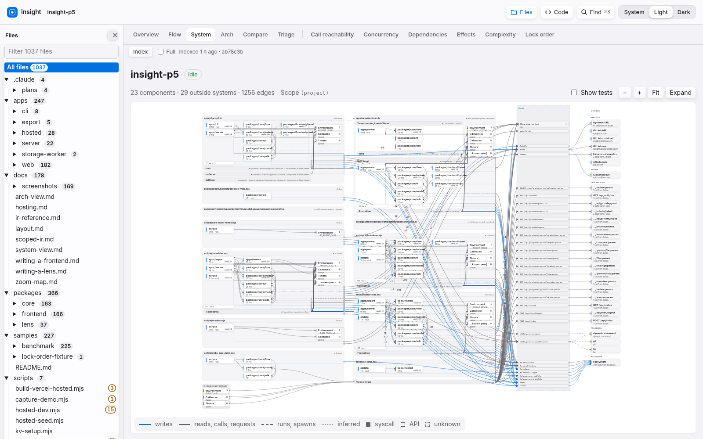
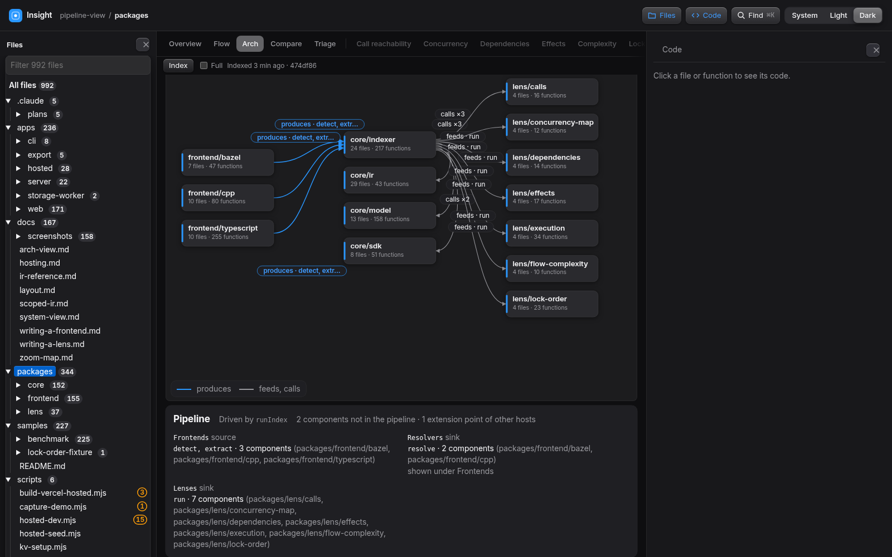

# System view

The System tab is a top-level tab, between Flow and Arch (`#/projects/<id>/view/system?scope=…`). It shows what the
code in the current explorer scope runs on and what it touches outside itself: processes, threads, coroutines, the
components that run on them, the queues and locks between them, the kernel, and the outside systems (network hosts,
API routes, the filesystem, child processes, stores).

Every box and edge answers three questions: which code caused it, where it runs, and how sure we are.

## Where it lives

| Tab | Modes |
| --- | --- |
| Overview, Flow, **System**, Arch, Compare, Triage, lenses | System has no modes. |
| Arch | **Pipeline** or **Packages** (Packages by default). |

Arch no longer holds System. A saved Arch mode of `"system"` from before the tab existed reads as Packages. The
System choice is not stored in the URL; the scope is.

The model is computed in the page by `api.getSystem`, so the live, static and hosted builds all show it. There is no
server route.

## Frames

The diagram is nested. A frame is a box that holds other boxes.

| Frame | What it is | Where it sits |
| --- | --- | --- |
| **Process** | A program: a Node or browser program, or a native executable. Labelled with the program name (`insight-server · Node`). | Left of the kernel band, stacked in a grid of 1 to 4 columns that fits the viewport. |
| **Thread** | One thread of a process. The process's first thread is drawn as "Main thread". | Rows inside the process frame. |
| **Coroutine** | A task that runs concurrently: a started async function, a generator or a C++ coroutine. | Inside its thread, or directly inside its process when the process has only the main thread. |
| **Not on a thread** | Code in the scope that no grounded thread reaches. | Inside its program, or at the bottom when no program owns it. Expanded like any other frame. |

The rules:

- **Main thread.** A process with only its main thread draws no thread frame. Its coroutines and slices sit directly in
  the process frame.
- **Synthetic `project` program.** Threads that no program owns (a C++ scope whose executables are all tests, for
  example) share one program of the scope, labelled with the scope's folder name, or `project` at the root. A thread is
  only counted when it runs code the System shows, so a spawn in a fixture or test file does not create a frame.
- **Child processes.** A child process with a resolved program target is its own process frame, and the spawning
  slice's edge goes to that frame's header. A child process with an unresolved target is a box beyond the kernel band
  (`git`, `tar`, or "dynamic command"). A C++ `fork()` is drawn as a "fork" process frame with no rows.
- **Only grounded threads.** A thread frame exists only where the IR grounds it: a program target, a real `main`, and a
  resolved spawn. This is the same rule the Flow tab uses.

### Coroutines and the "N coroutines" group

- Started coroutines (`how: start`) are drawn one frame each.
- Awaited coroutines run inline in the caller's sequence. They stay inside the caller's slice with an await marker,
  and show as a count, not a frame.
- A thread or process with **more than 3** coroutine frames (`GROUP_MIN = 3`, so four or more) draws one summary row,
  "N coroutines", instead of N frames. Its slices and its edges sit on the summary's header, so nothing is hidden.
- To open the group, click its row, or select the thread and press **Show the N coroutines** in the side panel. Press
  the same control again (**Group the N coroutines**) to fold it back.

## Slices

A **slice** is one component running on one thread or coroutine. A component reached by two threads appears in both
rows, and each slice counts only the functions that runtime reaches.

- A slice's panel names its placement: "root of this thread" when the thread's entry function is in the component, or
  "reached by calls from `<root>`". This placement is inferred from calls.
- A slice with no functions of its own (a hollow link in a call chain) is dropped, along with its edges.
- A frame shows up to **9** slices (`SLICE_LIMIT = 9`). Beyond that a "+N more" chip widens the frame. The chip does
  not switch a mode; it makes the frame bigger.
- Slices run in columns by stage, using the same column, lane and pill code as the flat layout.

## Resource strip

Each process frame has an **In process** strip on its right edge. It holds the resources that process owns:

| Resource | Glyph | Comes from |
| --- | --- | --- |
| Queue (message inbox) | ▤ | `postMessage` and `onmessage` between a page and its workers. Each receiver has one inbox. An unresolved peer gives "inbox (unknown peer)". |
| Queue (channel) | ▤ | `MessageChannel` and `BroadcastChannel` (TypeScript), queue types in the C++ catalog, and inferred guarded queues. |
| Event-loop queues | ▤ | "Timers", "Microtasks", "Callbacks", from `dispatches` with how `timer`, `microtask` or `callback`. |
| Lock | lock icon | `navigator.locks`, mutexes, rwlocks. |
| Semaphore | glyph | `std::counting_semaphore`, `binary_semaphore`, `sem_wait`, `sem_post`. |
| Condvar | glyph | `std::condition_variable`, `pthread_cond_*`, `Atomics.wait` and `notify`. |
| Environment | `$` | `effects.env.read`, shown as one box with the variable names. |

Edges to a resource use these verbs: `enqueues` and `dequeues` (queues), `locks` (acquire; release is folded into the
same edge), `waits` and `notifies` (condvar, semaphore). Atomic operations are counted on the lock's or slice's panel
and are not drawn.

A strip with nothing to show is not drawn.

## Kernel band

The **Kernel** band is a full-height column between the processes and the outside systems. An edge that leaves a slice
for disk, network or a child process crosses the band, with a chip on the band:

- the **syscall** name when the evidence has one (`unlink`, `connect`, `execve`);
- otherwise the **API** (`fs.readFile`, `fetch`).

Edges with the same chip share it, shown as `×N`.

Kernel-only operations (`effects.os.call`) end on boxes inside the band, one per op:

| Op | Box label | Examples |
| --- | --- | --- |
| `signal` | Signals | `process.kill`, `process.on`, `process.once`, `kill`, `raise`, `sigaction` |
| `process-control` | Process control | `process.exit`, `process.abort`, `fork`, `vfork` |
| `memory` | Memory maps | `mmap`, `munmap`, `mprotect` |
| `device` | Devices | `ioctl` |
| `raw-syscall` | Raw syscalls | `syscall()` |
| `info` | System info | `os.cpus`, `os.hostname`, `os.totalmem` and the other `os.*` reads |
| `fd` | File descriptors | `open`, `close`, `dup`, `dup2`, `pipe`, and the `fs.open*` / `fs.close*` / `fs.fstat*` calls |

Each op box lists the names it saw (signal names, for example), and the count. The band is sized from its labels.

An edge from a slice to a resource in the same process never crosses the band.

## Outside systems

The rightmost column holds what the process reaches beyond the kernel:

| Group | What it holds |
| --- | --- |
| Filesystem | Reads and writes. |
| Network | Catalog services (GitHub, Cloudflare, Vercel, npm), dynamic URLs, and `Listens :port` boxes for `net.listen`. |
| Processes | Child programs, named by the command. |
| Stores | Key-value and object stores named by their service. |
| This app's API | This app's own routes, as chips on the component that serves them. A relative request that matches a route goes from one slice to that slice and crosses no band. |

Route chips show on the serving slice (`POST /api/index`). An exported Vercel handler with no path in the code reads
`POST handler`. A component's card shows up to 4 route chips, then "+N more".

## Edges and the legend

| Style | Meaning |
| --- | --- |
| Solid, accent colour | **writes** |
| Solid, plain | **reads**, **calls**, **requests** |
| Dashed | **runs**, **spawns** |
| Faded, dotted | **inferred** |

Level marks show how the evidence was named:

| Level | Mark | Meaning |
| --- | --- | --- |
| syscall | solid square tag | The IR names the kernel call (`attrs.syscall`). |
| API | plain | A catalogued high-level call (`fetch`, `fs.readFile`). |
| unknown | hollow, dotted | The target is `<dynamic>`: a command or path the IR could not resolve. |

Edges are one per pair of nodes and verb. Facts are merged and the label counts them (`PUT ×5`). An edge keeps up to 20
sites (`SITE_CAP = 20`) and the full count. An edge's panel has an evidence table (API, syscall, level, count) above
its sites.

### Fact rules

The model is `systemModel(model, scope, { tests })` in `packages/core/model/src/system.ts`. The runtime is built by
`packages/core/model/src/system-runtime.ts` from `execModel`. A scope is a closed world: a fact that leaves it is not drawn.

| Fact (IR kind) | Emitted by | Becomes |
| --- | --- | --- |
| `effects.net.connect` (fetch, http requests) | TypeScript | A request to a host. A known host is a catalog service; an unknown host is its own service, named by the host. A relative URL is matched to a route served inside the scope first (same method, `:param` as a wildcard), then draws a `requests` edge to that component. GET and HEAD read; other methods write. |
| `effects.net.serve` (routes) | TypeScript | A route chip on the component that serves it, and the target of matching relative requests. Frameworks and exported handlers are both routes. |
| `effects.net.listen` | TypeScript, C++ | A `listens` edge to a `Listens :port` box. |
| `effects.fs.read`, `effects.fs.write` | TypeScript, C++ | `reads` or `writes` to the Filesystem external. |
| `effects.proc.exec` | TypeScript | `runs` to a Process external named by the program (`git`, `tar`), or "dynamic command". |
| `effects.env.read` | TypeScript, C++ | `reads` from the In-process env resource. |
| `effects.clock.read` | TypeScript, C++ | Hidden. Not drawn. |
| `effects.message.post` | TypeScript | An `enqueues` edge to the receiver's inbox, or to "inbox (unknown peer)" when the receiver is not resolved. |
| `effects.os.call` | TypeScript, C++ | A box in the Kernel band, one per `op`, with the names it saw. Its `api` and `syscall` give the chip evidence. |
| `concurrency.spawn-thread` | TypeScript, C++ | A thread in the spawning program when its target resolves. |
| `concurrency.spawn-process` | TypeScript, C++ | A child process frame when the target is a project program, else a process box beyond the band. |
| `concurrency.spawns` (edge) | TypeScript, C++ | The spawning slice to the spawned thread or process header. |
| `concurrency.coroutine` | TypeScript, C++ | A coroutine frame (started), or a count (awaited). |
| `concurrency.await` | TypeScript, C++ | An await marker on the caller's slice. |
| `concurrency.dispatches` (edge) | TypeScript, C++ | An event-loop queue (`timer`, `microtask`, `callback`) or a message handoff (`message`) to an inbox. |
| `concurrency.channel-send`, `concurrency.channel-recv` | TypeScript (`MessageChannel`, `BroadcastChannel`); C++ (queue methods) | `enqueues` and `dequeues` on the queue named by `attrs.channel`. |
| `sync.lock-acquire`, `sync.rwlock-acquire` | TypeScript (`navigator.locks`); C++ (`std::shared_mutex`, `shared_lock`, mutex `lock`) | `locks` on the lock resource named by `attrs.lock`. |
| `sync.lock-release` | C++ | Folded into the matching `locks` edge. |
| `sync.semaphore` | C++ | `waits` or `notifies` on a semaphore resource. |
| `sync.condvar` | TypeScript (`Atomics.wait`, `Atomics.notify`); C++ (`std::condition_variable`, `pthread_cond_*`) | `waits` or `notifies` on a condvar resource. |
| `sync.atomic-op` | TypeScript, C++ | Counted on the lock's or slice's panel. Not drawn. |
| calls, references | TypeScript, C++ | Edges between components, with candidates counted as inferred. |
| imports with no call | TypeScript, C++ | Inferred edges between components, only where no call joins the two. |

The `effects.unknown` kind is not emitted by any frontend yet. Unrecognised external calls are not drawn.

### Services catalog

`packages/core/model/src/services.ts` maps hosts to named services: GitHub API, GitHub codeload, GitHub raw, Cloudflare
API (with path rules: `/storage/kv/` is Cloudflare KV, `/r2/` is Cloudflare R2), Cloudflare R2
(`*.r2.cloudflarestorage.com`), Cloudflare Worker (`*.workers.dev`), Vercel API and the npm registry. A host matches
exactly or by suffix. Add a row to `SERVICES` to name another one.

### Stages and entries

An entry is a component that serves a route or holds a program entry (a function named `main`, or a CLI or main file).
Another component that nothing calls starts column 0 only when it has facts going out. Columns come from a breadth-first
walk over calls, requests and spawns from those entries. A component none of them reaches goes in a last column.
Components with no functions, route or fact (a lone `package.json`, lockfiles) are dropped.

### Tests hidden by default

Tests, fixtures and samples follow the Flow tab's noise rule and are left out. Turn on **Show tests** in the toolbar to
include them. A scope that is itself inside a test folder shows its tests without the switch.

### Pass-through descend

When a scope holds exactly one folder of code (`apps/hosted` holds `src`), the view shows that folder's children and the
toolbar notes `via src`. It repeats for up to 8 levels (`MAX_VIA = 8`), so a chain of single folders does not give a
one-card view.

## Exit ports and trunks

Each process frame has **exit ports** on its right edge, one per edge that leaves it. Ports run down the edge in the order
of their targets, so the lines do not cross. Edges that reach the same kernel-band chip or outside box share a **trunk**
from the port to the target. A trunk carries a **×N** pill with the number of edges it stands for. Selecting a trunk's
pill or edge shows its sites.

## Levels, scope drill-down and navigation

| Action | Effect |
| --- | --- |
| Double-click a component, or press **Open** in its panel | Makes it the scope. The URL's `scope=` changes. |
| Click a frame header | Selects the frame; the panel shows it. |
| **Fit** | Fits the whole diagram in the stage. |
| **Expand** | Fills the window. **Esc** leaves. |
| `+` / `−` | Zoom in and out. |
| Drag, wheel | Pan and zoom. |
| Hover a card or an edge | Lights its neighbours. |

Keyboard: frame headers, components, outside boxes, "+N more" chips and edges are all focusable. **Tab** moves between them.
On a frame header, **Enter** selects the frame (the panel shows it, with its Collapse, Group and Show all buttons), and
**Space** collapses or expands it. Enter on a coroutine summary opens it. On a "+N more" chip, **Enter** or **Space**
shows all the slices; on a component, an outside box or an edge, it selects it.

Zooming out stops at 0.1, or at the scale of the last fit when that is smaller, so zooming out never zooms in. Collapsing,
widening or grouping keeps your zoom and pan; only a new model, a different layout or **Expand** refits.

The first view fits the stage. The System fit has a floor of 0.02, so a large project shows its whole frame structure at
a small scale rather than cutting it off; the Pipeline fit has a floor of 0.56. Pills are shown for every edge up to 30
edges (`PILL_LIMIT = 30`). Above that, only the hovered or selected node's edges show a pill; the other edges are plain
lines.

While System is shown and no code is open, the right Code pane starts collapsed to give the diagram width. Opening code
(a `file:line` link, or the Code button) brings it back, and leaving System restores it.

## Degradation

| State | What you see |
| --- | --- |
| Computing | "Computing runtime…" while the model is computed on a later task. The page paints first. |
| No runtime entry | No process or thread frames. Components are laid out as flat cards, with the kernel band and the outside column still drawn. In-process resources sit in one strip labelled "In process (no entry found)". The toolbar says "No runtime entry in this scope". |
| Runtime skipped | The exec model was cut because the scope is too large. The view is flat and the toolbar says "Runtime skipped: the scope is too large to trace (N functions skipped)". |
| Older snapshot | A snapshot indexed before `effects.os.call` existed shows no Kernel box. The model is rebuilt from the IR, so there is no stored-shape migration. |

## Performance

The exec model splits into two parts:

- `execPlans(nodes, edges)` (`packages/core/flow/src/exec-model.ts`) computes everything that does not depend on the
  scope: adjacency, programs and entries, thread bodies, coroutines and chart sizes. It is memoized per `nodes` and
  `edges` array in a `WeakMap`.
- `execModel` reads those plans for each scope. The output is byte-identical to the old single-pass function, and a test
  keeps a copy of the old function and compares the JSON.

The P0 probe (`scripts/probe-exec-sizing.mjs`) measured `execModel` with no function cap, as the median of 3 runs:

| Project + scope | Functions in scope | exec ms (no cap) | exec ms (default cap) |
| --- | --- | --- | --- |
| worktree, root | 4062 | 1812 | 1562 (truncated) |
| worktree, `packages` | 1644 | 863 | 743 |
| cognition, root | 3374 | 1178 | 556 (truncated) |
| `samples/benchmark`, root | 967 | 45 | 28 |

Acceptance for P4 was: the first call at the repo root no slower than the old 1.8 s, and a second scope on the same model
under 150 ms. The cache makes the second and later scopes skip the project-wide work.

## Known limits

From the design plan's out-of-scope list:

- `effects.unknown` and the C++ `async-task` kind are not emitted. Unknown external calls are not drawn.
- Queues that are not catalogued or lock-guarded are not drawn. This includes an array used as a queue in TypeScript,
  Node streams, `EventEmitter` events, and job-queue libraries such as BullMQ. Add catalog rows to draw them.
- Queue and lock identity is by name string. Same-named members of different instances merge into one resource.
- Join bars, message ordering and per-call-site boxes are not drawn. The graph stays aggregated.
- Placement is by call reachability. A callback passed into a library and run on another thread is not followed to
  that thread.
- Cross-package calls in hosted indexes resolve through workspace specifiers (#53), but a bare npm import still ends
  at the package boundary.
- C++ `fork()` children have no resolved target. The child is drawn as a "fork" process frame with no rows.
- Native C++ programs are framed only through build targets plus `main` (`exec-model.ts:630`). A `main` with no build
  target is still a name match, and is labelled inferred.

Other limits, from the code and from the earlier view:

- `process.on` and `process.once` are matched only for a literal string that starts with `SIG`, and only on the global
  `process`. A numeric signal (`process.on(15, …)`) and a `process` reached through an alias are not matched. A signal
  name that is not a literal shows as `<dynamic>`.
- `process.kill` with no literal signal argument defaults to `SIGTERM` as the target.
- Awaited coroutines show as a count, not as a frame. Only started coroutines get frames, so an async function that is
  always awaited does not appear as its own box.
- Clock reads are hidden on purpose. Atomic operations are counted, not drawn.
- The plan's first sizing proposal was `SLICE_LIMIT = 12`. The code uses 9. The view's cutoff is 9.
- A dynamic host is followed through one `const` hop (same file or enclosing scope). A host built further away is an
  unknown service.
- A `fetch` matched to a route by name only (no URL to match) is inferred and drawn faded.
- The hosted featured index holds the snapshot it was seeded from. New facts show in the hosted site only after a
  re-index (`scripts/hosted-seed.mjs`, or the index action) following the deploy.
- Components far apart still draw dense bundles of edges at root scope. Pick a narrower scope, or hover a card to read
  them.

## Pipeline mode

Arch's Pipeline mode shows the processing stages of the explorer scope: where the scope's data comes from, which
component handles it, and where it goes. It is derived by `pipelineModel(model, scope, { tests })` in
`packages/core/model/src/pipeline.ts`, computed in the page by `api.getPipeline`, and drawn by the same `layoutSystem`
and card, edge and panel code.

- **Extension points** are interface call sites: a call through an interface (or abstract class) whose implementers sit
  in two or more components of the scope. The receiver names the point and its label is the receiver, capitalised and
  pluralised (`frontend` → "Frontends", `lens` → "Lenses"). Points with the same host and implementers are one point.
- **Host** is the component that holds the most extension points (ties go to the most call sites, then the id).
  Extension points of other hosts are not drawn and are counted in the panel.
- **Order** comes from the driver: the host function that reaches the most extension points through calls inside the
  host (the deepest one on a tie). A point's key is the driver's first call on the way to one of its sites, so points
  run in the order the driver calls them. A point the driver does not reach goes last, and without a driver the order
  is by file and line.
- **Roles.** The first point is the source (`role: source`), every later point is a sink. The first point is assumed to
  be the producer: nothing in the model says which way the data flows, so the order is the assumption.
- **Columns**, left to right: the source's implementers, the host with the components it calls exactly (`calls`, not
  candidates), then each sink's implementers. A component is drawn in the first column that claims it, so a point whose
  implementers are all drawn in an earlier column gets no column (the panel says "shown under ...").
- **Edges.** A source's implementer produces into the host (`produces`, labelled with the point's members), and the host
  feeds each sink's implementer (`feeds`, labelled with the members). Produces edges are accent coloured, feeds are
  plain, and both are drawn solid even though their confidence is inferred.
- **Same-column calls are not drawn.** They become a note on the host card and a "Host calls" line in the side panel.
- **Empty state.** When the scope has no extension point the model gives a `reason`, and the stage says "No extension
  points in this scope. Pick a parent scope."

Limits:

- The first point is assumed to be the producer. A pipeline that starts from a sink is drawn the same way, with its
  arrows in the order of the driver.
- A point whose implementers are all drawn in earlier columns gets no column of its own, so it appears only in the panel.
- Points are interface dispatch only. A pipeline made of plain function calls, or of routes, is not drawn.
- The feeds arrows of many sinks run close together at the host's right side in a dense graph. Hover a card to read
  its arrows.

Tests: `apps/web/test/pipelineLayout.test.tsx` and `packages/core/model/test/pipeline*.test.ts`.

## Tests

- `apps/web/test/systemFrames.test.tsx`: frame nesting, coroutine groups, empty frames, skipped note, ports and trunks.
- `apps/web/test/systemView.dom.test.tsx`: keyboard (Tab reaches frame headers, Enter toggles), toolbar notes.
- `apps/web/test/systemFixtures.ts`: the hand-built fixtures the tests use.
- `packages/core/model/test/system.test.ts`, `system-runtime.test.ts`: the model and runtime.
- `packages/core/flow` tests: `execPlans` output equals the old single-pass `execModel`.
