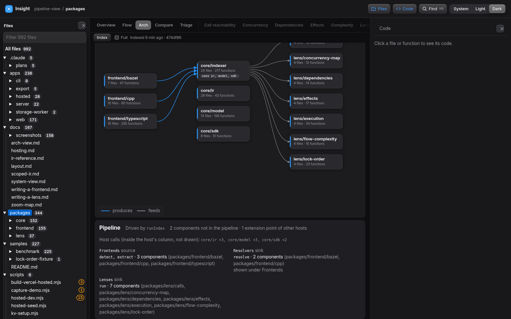

# System view

The System view is a mode of the Arch tab (the System / Pipeline / Packages toggle, System by default). It answers "what does this
code talk to?" for the current explorer scope: the components inside the scope, the routes they serve, the outside
systems they reach and the verbs between them.

## What it shows

- **Components** are the children of the scope: packages when the scope holds `package.json` roots, else its folders and
  files. A card shows the file and function counts and up to four route chips (`POST /api/index`, then "+N more").
- **Columns** run left to right by stage: entries first, then what they call, and so on. The last column holds the
  **outside systems**, grouped by category (Services, Stores, This app's API, Processes, Filesystem, Config, Workers).
- **Edges** are curves from a card side to a card side, with a verb pill (`writes · PUT ×2`, `runs · git`). Writes are
  accent coloured, runs and spawns dashed, inferred edges dotted and faded. Hover a card or an edge to light its neighbours;
  click to open the side panel with the sites (`file:line`, each with a link to the code and to the function's Flow chart).
  Double-click a component, or press Open in the panel, to make it the scope.
- The scope is computed in the page from the project model (`api.getSystem`), so the demo and hosted builds show it too.

## Fact rules

The model is `systemModel(model, scope, { tests })` in `packages/core/model/src/system.ts`. A scope is a closed world: a fact
that leaves it is not drawn.

| Fact (IR kind) | Becomes |
| --- | --- |
| `effects.net.connect` (fetch, http requests) | A request to a host. A known host is a catalog service, an unknown host is its own service named by the host. A relative URL is matched to a route served inside the scope first (same method, `:param` as a wildcard) and then draws a `requests` edge to that component. The verb follows the method: GET and HEAD read, the rest write. |
| `effects.net.serve` (routes) | A route chip on the component that serves it, and the target of matching relative requests. Frameworks and exported Vercel-style handlers are both routes. |
| `effects.fs.read`, `effects.fs.write` | `reads` or `writes` to the Filesystem external. |
| `effects.proc.exec` | `runs` to a Process external named by the program (`git`, `tar`) or "dynamic command". |
| `effects.env.read` | `reads` to the Config external, labelled with the variable count, the names in its sub line. |
| `effects.message.post` | A `posts` edge (`postMessage`) to the "Peer (postMessage)" worker external. |
| calls, references, spawns | Edges between components, with candidates counted as inferred. Imports with no call joining the two components draw an inferred edge. |

Edges are one per pair of nodes and verb: facts are merged and the label counts them (`PUT ×5`). The edge keeps up to 20
sites and the full count. An edge is exact unless any of its facts is inferred.

### Services catalog

`packages/core/model/src/services.ts` maps hosts to named services: GitHub API, GitHub codeload, GitHub raw, Cloudflare API
(with path rules: `/storage/kv/` is Cloudflare KV, `/r2/` is Cloudflare R2), Cloudflare R2 (`*.r2.cloudflarestorage.com`),
Cloudflare Worker (`*.workers.dev`), Vercel API and the npm registry. A host matches exactly or by suffix. Add a row to
`SERVICES` to name another one.

### Stages and entries

An entry is a component that serves a route or holds a program entry (a function named `main`, or a CLI or main file).
Another component that nothing calls starts column 0 only when it has facts going out. Columns come from a breadth-first
walk over calls, requests and spawns from those entries. A component none of them reaches goes in a last column.
Components with no functions, route or fact (a lone `package.json`, lockfiles) are dropped.

### Tests hidden by default

Tests, fixtures and samples follow the Flow tab's noise rule and are left out. Turn on "Show tests" in the toolbar to
include them. A scope that is itself inside a test folder shows its tests without the switch.

### Pass-through descend

When a scope holds exactly one folder of code (`apps/hosted` holds `src`), the view shows that folder's children and
the toolbar notes `via src`. It repeats for up to eight levels, so a chain of single folders does not give a one-card view.

## Layout

The geometry is `layoutSystem` in `apps/web/src/arch/system-layout.ts`, pure and deterministic.

- Cards stack in columns. A short edge is one cubic curve inside the gap between two columns. An edge that spans more than
  one column and whose straight curve would cross a card instead leaves into the gap, runs along a lane above or below all
  the cards and enters the gap before its target, so no edge goes through a card that is not one of its ends.
- Verb pills sit on their curve, slid along it (0.3 to 0.7 of its length) and then offset until they touch no card and no
  other pill. Above 30 edges the pills are shown only for the hovered or selected node's edges (the others are lines).
- While System is shown and no code is open, the workspace starts with the right Code pane collapsed, to give the diagram width. Opening code (a `file:line` link) or the Code button brings it back, and leaving System restores it. A last column of components that nothing connects to is folded into the column before it.
- Lanes run just above the top card (below the bottom card) of the columns they cross, 4 px apart, inside the layout's bounds.
- When part of the graph is off-screen, a fade on the right edge and a "drag to pan · Fit" hint say so.
- The first view is fitted to the stage but never smaller than 0.56, so a card title (18 px) renders at 10 px or more. A
  wider graph is panned (drag, wheel zoom, `-`/`+`, Fit). Expand fills the window (Esc leaves). The stage is as tall as the
  window leaves room for, at least 60vh.

Tests: `apps/web/test/systemLayout.test.tsx` (no pill overlaps another pill or a card, no edge sample point inside a
non-endpoint card, for a hosted-like and a dense 20-component, 60-edge fixture) and `packages/core/model/test/system*.test.ts`.

## Pipeline mode

The Arch tab has three modes: System | Pipeline | Packages (System by default, the reader's choice is kept in localStorage).
Pipeline shows the processing stages of the explorer scope: where the scope's data comes from, which component handles it, and
where it goes. It is derived by `pipelineModel(model, scope, { tests })` in `packages/core/model/src/pipeline.ts`, computed in the
page by `api.getPipeline` like the System view, and drawn by the same `layoutSystem` and card, edge and panel code.

- **Extension points** are interface call sites: a call through an interface (or abstract class) whose implementers sit in two or
  more components of the scope. The receiver names the point and its label is the receiver, capitalised and pluralised
  (`frontend` → "Frontends", `lens` → "Lenses"). Points with the same host and implementers are one point.
- **Host** is the component that holds the most extension points (ties go to the most call sites, then the id). Extension points
  of other hosts are not drawn and are counted in the panel.
- **Order** comes from the driver: the host function that reaches the most extension points through calls inside the host (the
  deepest one on a tie). A point's key is the driver's first call on the way to one of its sites, so points run in the order the
  driver calls them. A point the driver does not reach goes last, and without a driver the order is by file and line.
- **Roles.** The first point is the source (`role: source`), every later point is a sink. The first point is assumed to be the
  producer: nothing in the model says which way the data flows, so the order is the assumption.
- **Columns**, left to right: the source's implementers, the host with the components it calls exactly (`calls`, not candidates),
  then each sink's implementers. A component is drawn in the first column that claims it, so a point whose implementers are all
  drawn in an earlier column gets no column (the panel says "shown under ..."). Column titles: `Frontends ×3 · detect, extract` (the
  point's label, its component count and its members), `Host · indexer` for the host's package.
- **Edges.** A source's implementer produces into the host (`produces`, labelled with the point's members: `detect, extract`), and
  the host feeds each sink's implementer (`feeds`, labelled with the members: `run`). Produces edges are accent coloured, feeds are
  plain, and both are drawn solid even though their confidence is inferred: they are the point of the view. Verb pills show only
  for the hovered or selected edge. The edge's sites are the call sites of the point.
- **Same-column calls are not drawn.** The host's calls to components in its own column would loop back through a gap, so they
  are not edges. They become a note on the host card (`uses ir, model, sdk`) and a "Host calls" line in the side panel
  (`packages/ir, packages/sdk`, with `×N` for several sites). The model keeps them as `calls` edges.
- **Side panel** with nothing selected (under the diagram): the driver ("Driven by runIndex"), each point in order with its role, its
  members and its component count, and the counts "N components not in the pipeline" (omitted) and "N extension points of other
  hosts" (dropped). Clicking an edge or a card works as in System: the sites open in the Code pane, and a function links to its
  Flow chart.
- **Empty state.** When the scope has no extension point the model gives a `reason`, and the stage says "No extension points in
  this scope. Pick a parent scope."

Limits:

- The first point is assumed to be the producer. A pipeline that starts from a sink (a dispatch whose first point is a consumer)
  is drawn the same way, with its arrows in the order of the driver.
- A point whose implementers are all drawn in earlier columns gets no column of its own, so it appears only in the panel.
- Points are interface dispatch only. A pipeline made of plain function calls, or of routes, is not drawn.
- The feeds arrows of many sinks run close together at the host's right side in a dense graph. Hover a card to read its arrows.

Tests: `apps/web/test/pipelineLayout.test.tsx` (column titles and order, verbs and styles, rows and the summary, the empty model and
its message, the mode toggle) and `packages/core/model/test/pipeline*.test.ts`.

## Known limits

- Exported Vercel handlers (`export async function POST`) have no path in code, so the route chip reads `POST handler`.
- A `fetch` matched to a route by name only (no URL to match) is inferred and drawn faded.
- A dynamic host is followed through one `const` hop (same file or enclosing scope). A host built further away is an
  unknown service.
- The hosted featured index holds the snapshot it was seeded from. New facts show in the hosted site only after a
  re-index (`scripts/hosted-seed.mjs`, or the index action) following the deploy.
- Components far apart still draw dense bundles of edges at root scope. Pick a narrower scope or hover a card to read them.
